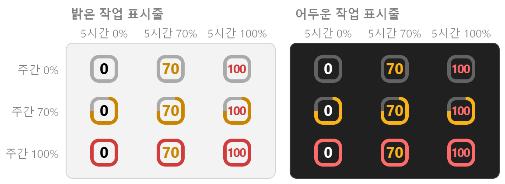
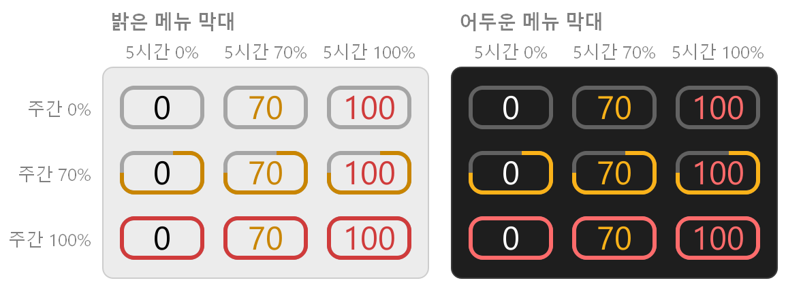

# TokenViewer

Claude Code 요금제의 5시간·주간 한도를 Windows 알림 영역과 macOS 메뉴 막대에 늘 띄워 두는 앱입니다.
아이콘을 누르면 리셋 시각과, 로컬 세션 로그로 계산한 프로젝트·모델·세션별 API 환산 비용이 나옵니다.

## 아이콘 읽는 법

아이콘 하나에 두 한도를 함께 보여 줍니다.

- **가운데 숫자**: 5시간 한도 사용률(%).
- **테두리**: 주간 한도 사용률. 9시 방향에서 시작해 아래쪽으로 돌며 차오르고, 한 바퀴를 다 채우면 주간 한도를 다 쓴 것입니다.
- **색**: 숫자는 5시간 값, 테두리는 주간 값을 따라 따로 바뀝니다. 70% 이상이면 주황, 90% 이상이면 빨강이고 (설정에서 바꿀 수 있습니다), 그 아래는 작업 표시줄·메뉴 막대의 글자색 그대로입니다.
- 값을 아직 못 받았으면 `—` 를, 갱신이 15분 넘게 실패하면 마지막 값을 흐리게 보여 줍니다.

### Windows



### macOS



드롭다운의 5시간·주간 막대도 같은 기준으로 파랑, 주황, 빨강으로 바뀝니다.

## 개발 (빌드·실행)

### Windows

Qt 5.15.2 MinGW 64-bit, MinGW 8.1 (Qt 설치 프로그램의 Developer and Designer Tools), CMake 3.22 이상, Ninja 가 필요합니다.
설치 프로그램까지 만들려면 [Inno Setup 6](https://jrsoftware.org/isinfo.php) 도 필요합니다.

```powershell
$env:PATH = "C:\Qt\Tools\mingw810_64\bin;C:\Qt\5.15.2\mingw81_64\bin;$env:PATH"
cmake -S qt -B build-win -G Ninja -DCMAKE_BUILD_TYPE=Debug -DCMAKE_PREFIX_PATH=C:/Qt/5.15.2/mingw81_64
cmake --build build-win
ctest --test-dir build-win --output-on-failure
.\build-win\TokenViewer.exe              # 실행. 끌 때는 .\build-win\TokenViewer.exe --quit
```

배포 파일 (Release 빌드, zip, 설치 프로그램이 `qt\dist` 에 생깁니다):

```powershell
powershell -ExecutionPolicy Bypass -File qt\scripts\package-windows.ps1
```

### macOS

Xcode 16 이상이 필요합니다.

```bash
cd macos
swift test                                        # 단위 테스트
scripts/build-app.sh --debug && open dist/TokenViewer.app   # 디버그 빌드 후 실행
scripts/build-app.sh                              # universal 릴리스 빌드 + zip + dmg
```

## 설치

### Windows 10 (1903 이상) · 11, x64

[최신 릴리스](https://github.com/jdragon96/TokenViewer/releases/latest)에서 `TokenViewer-windows-setup.exe` 를 받아 실행합니다.
관리자 권한 없이 사용자 폴더에 설치되고 시작 메뉴에 등록됩니다. PowerShell 한 줄로도 됩니다 (같은 명령으로 업데이트):

```powershell
irm https://github.com/jdragon96/TokenViewer/releases/latest/download/install.ps1 | iex
```

설치 없이 쓰려면 `TokenViewer-windows.zip` 을 풀고 `TokenViewer.exe` 를 실행합니다.
제거는 설정 → 앱 (설치된 앱, Windows 10 은 앱 및 기능) 에서 TokenViewer 를 고릅니다.

- Windows 11 은 새 트레이 아이콘을 작업 표시줄 오른쪽 `^` 안에 숨깁니다. 아이콘을 작업 표시줄로 끌어다 놓거나, 설정 → 개인 설정 → 작업 표시줄 → 기타 시스템 트레이 아이콘에서 켜세요.
- 서명하지 않은 앱이라 브라우저로 받은 파일은 SmartScreen 이 처음 한 번 막습니다. "추가 정보" → "실행" 을 누르세요.

### macOS 14 이상

```bash
curl -fsSL https://github.com/jdragon96/TokenViewer/releases/latest/download/install.sh | bash
```

Homebrew 는 `brew install --cask jdragon96/tap/tokenviewer`, 브라우저로는 릴리스의 `TokenViewer-macos.dmg` 를 열어 Applications 로 끌어다 놓습니다.
제거 (설정과 로그 포함):

```bash
curl -fsSL https://github.com/jdragon96/TokenViewer/releases/latest/download/install.sh | bash -s -- --uninstall
```

Homebrew 로 설치했다면 `brew uninstall --cask --zap tokenviewer` 로 지웁니다.

- 처음 실행하면 Keychain 의 `Claude Code-credentials` 접근을 묻습니다. "항상 허용"을 누르세요 (업데이트할 때마다 한 번 더 묻습니다).
- DMG·Homebrew 로 설치하면 처음 한 번 시스템 설정 → 개인정보 보호 및 보안 → "그래도 열기" 가 필요합니다.

## 라이선스

[MIT](LICENSE).
Windows 앱은 Qt 5.15 (LGPLv3) 를 DLL 로 동적 링크하고 MinGW-w64 런타임 DLL 을 함께 넣으며, 설치 프로그램은 Inno Setup 으로 만듭니다.
고지는 [`qt/resources/THIRD_PARTY_NOTICES.md`](qt/resources/THIRD_PARTY_NOTICES.md) (앱의 설정 → "오픈소스 라이선스") 에, 라이선스 전문은 설치 폴더의 `licenses\` 에 있습니다.
